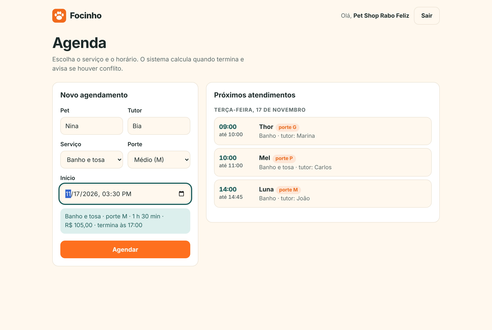
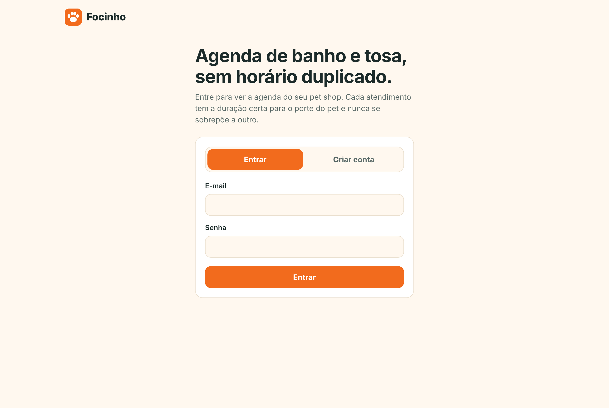
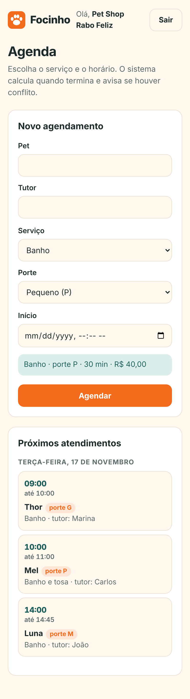

# Focinho

Agenda de banho e tosa para pet shops, **sem horário duplicado**. O dono entra na própria conta, marca os atendimentos e o sistema calcula quando cada um termina (a duração depende do serviço e do porte do pet) e recusa qualquer horário que se sobreponha a outro.



<p>
  
  
</p>

## O que o sistema faz

- **Conta do pet shop**: cadastro e login. Cada dono vê e agenda apenas na própria agenda; dois pet shops podem ter o mesmo horário sem se bloquear.
- **Catálogo por porte**: banho, tosa e banho e tosa, cada um com duração e preço próprios para pets pequenos (P), médios (M) e grandes (G).
- **Agendamento sem conflito**: o horário de término é calculado a partir do serviço e do porte. Se o novo atendimento se sobrepõe a outro, a API responde `409` e diz o motivo.
- **Regras de expediente**: não agenda no passado, fora dos dias de funcionamento nem fora do horário de abertura e fechamento (configuráveis).

### A regra de conflito

Dois atendimentos conflitam quando **o início de um é antes do fim do outro e o fim dele é depois do início do outro**:

```
A.inicio < B.fim  &&  A.fim > B.inicio
```

Encostar na borda não é conflito: um atendimento que termina às 10h e outro que começa às 10h convivem. Já 10h–11h e 10h30–11h30 conflitam. A regra vive em um só lugar, o `record Periodo`, e tem testes para sobreposição parcial, um período dentro do outro, períodos idênticos, bordas, 1 minuto de diferença e dias diferentes.

## Tecnologias

| Camada | O que usei |
| --- | --- |
| Linguagem e framework | Java 21, Spring Boot 4.1 (Web, Data JPA, Validation, Security) |
| Banco | MySQL (H2 em memória nos testes) |
| Segurança | Senhas com BCrypt, sessão com cookie, proteção CSRF ligada |
| Tela | HTML, CSS e JavaScript puros, servidos pelo próprio Spring |
| Qualidade | JUnit 5, MockMvc, testes HTTP reais, GitHub Actions |
| Deploy | Docker, Render e MySQL no Aiven |

## Como rodar na sua máquina

Você precisa de Java 21 e de um MySQL rodando (o do XAMPP serve).

```bash
git clone https://github.com/KAUAN-KAWASAKI/focinho.git
cd focinho
./mvnw spring-boot:run
```

Abra `http://localhost:8080`. Na primeira execução o banco `focinhodb` e o catálogo de serviços são criados sozinhos.

Por padrão o app usa o usuário `root` sem senha em `127.0.0.1:3306`. Para mudar, defina variáveis de ambiente (nunca coloque senha no código):

| Variável | Padrão | Para que serve |
| --- | --- | --- |
| `DB_URL` | `jdbc:mysql://127.0.0.1:3306/focinhodb?createDatabaseIfNotExist=true&serverTimezone=UTC` | endereço do banco |
| `DB_USERNAME` | `root` | usuário |
| `DB_PASSWORD` | vazio | senha |
| `PORT` | `8080` | porta (a hospedagem define) |

## Testes

```bash
./mvnw verify
```

São 62 testes, e nenhum precisa de MySQL (usam H2 em memória). O GitHub Actions roda a mesma coisa em cada pull request.

- Regra de conflito e bordas (`PeriodoTest`, `AgendamentoServiceTest`)
- Regras de expediente e relógio fixo para os testes não dependerem do dia em que rodam
- Segurança: rotas protegidas, agenda separada por dono, senha nunca devolvida, CSRF
- `FluxoHttpRealTest`: sobe o servidor de verdade e faz cadastro, login e sessão por HTTP, como o navegador

## API

| Método e rota | Acesso | O que faz |
| --- | --- | --- |
| `POST /api/donos` | público | cria a conta do pet shop |
| `POST /login` e `POST /logout` | público | entra e sai (formulário) |
| `GET /api/donos/eu` | logado | dados de quem está logado |
| `GET /api/servicos` | logado | catálogo com duração e preço por porte |
| `GET /api/agendamentos` | logado | agenda do dono, por horário |
| `POST /api/agendamentos` | logado | cria um agendamento (`409` se houver conflito, `422` se o horário for inválido) |

Exemplo de erro: `{"message": "Já existe um agendamento que se sobrepõe a este horário"}`.

## Deploy

O `Dockerfile` compila o projeto em uma etapa e roda só o `.jar` em uma imagem enxuta. Para publicar no Render com banco no Aiven:

1. No Aiven, crie um MySQL gratuito e copie host, porta, usuário e senha.
2. No Render, crie um *Web Service* a partir deste repositório (ambiente Docker).
3. Nas variáveis de ambiente do serviço, defina `DB_URL` (`jdbc:mysql://HOST:PORTA/defaultdb?sslMode=REQUIRED`), `DB_USERNAME` e `DB_PASSWORD`.

## Decisões e limites

- **Fuso horário fixo** (`focinho.fuso=America/Sao_Paulo`): servidores em UTC, como o do Render, calculariam "horário que já passou" com 3 horas de diferença.
- **Anti-conflito com `synchronized`**: duas requisições simultâneas não passam juntas pela checagem. Isso vale para **uma instância** do app; com várias instâncias seria preciso uma restrição no banco ou um bloqueio distribuído.
- **Cadastro aberto**: qualquer pessoa pode criar uma conta de pet shop. Para um produto real, valeria confirmar o e-mail.
- **Sem cadastro de clientes e pets**: o agendamento guarda só o nome do pet e do tutor. Um cliente e um pet próprios são a evolução natural.
- **Sem cancelar ou remarcar** pela tela ainda.

## Como o projeto foi construído

Uma tarefa por vez: issue, branch, pull request e merge, com testes e CI desde a regra de conflito. As etapas foram estrutura do projeto, porte e serviço, agendamento com a regra de conflito, testes e CI, login do dono, tela com deploy e este README.
